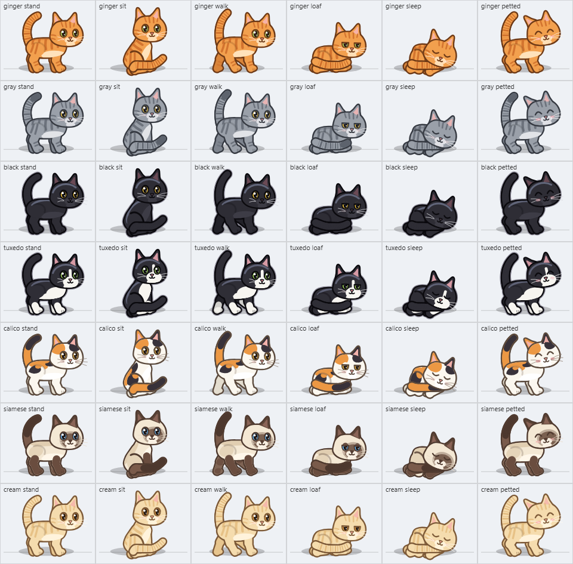
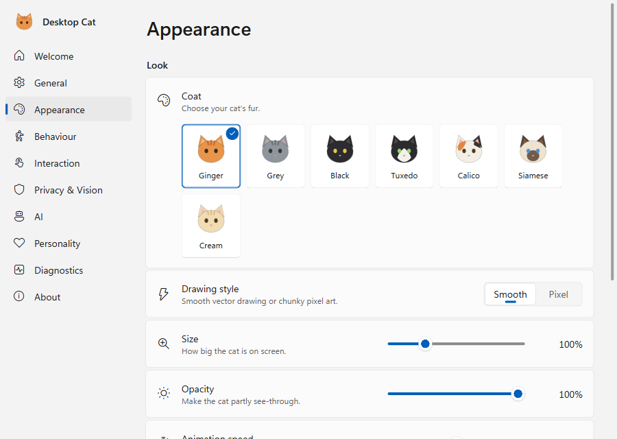
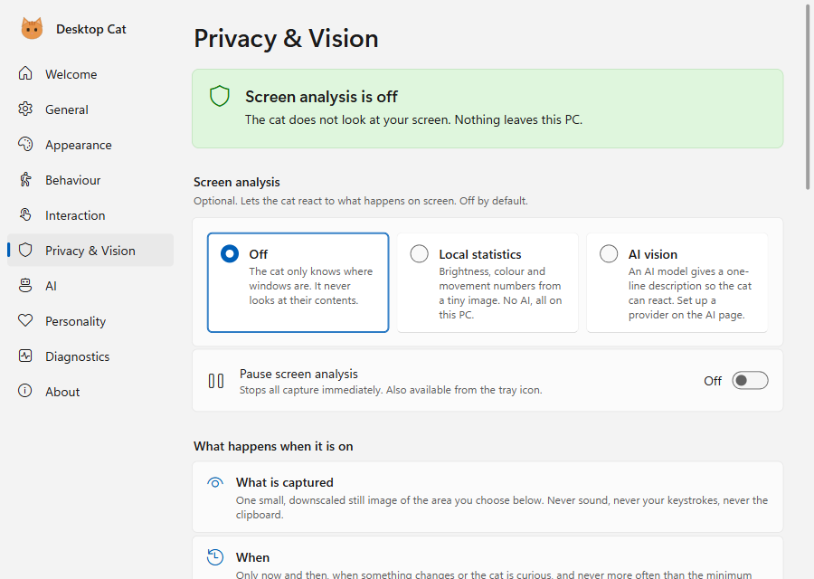
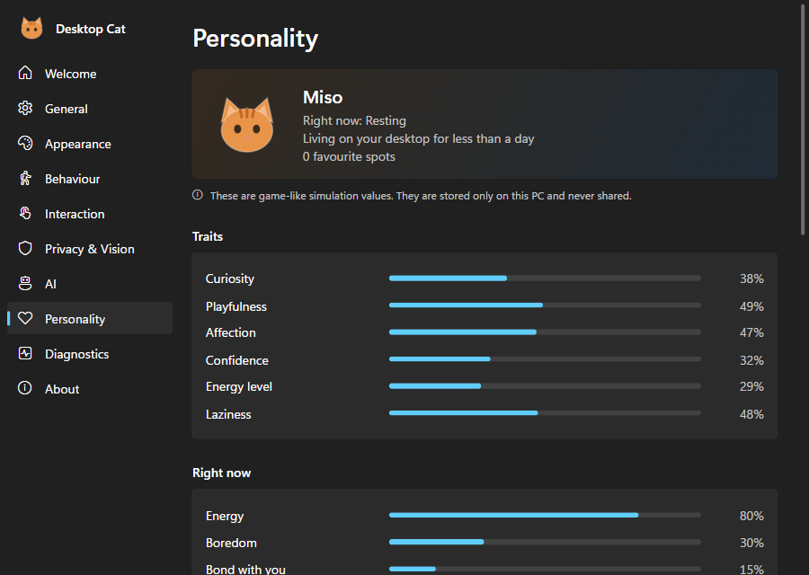

# Desktop Cat

A living desktop companion for Windows: **one** animated, persistent cat that lives on top of your desktop, wanders along the bottom of your screen, climbs the sides of windows and walks along their tops and along browser tab strips, rides an auto-hiding taskbar as it slides in, naps when you're away, watches you work, reacts to windows opening and closing, and can be petted, picked up and thrown — without ever getting in the way of your clicks. It starts with Windows (you can turn that off).



- **Original procedural art** — a vector rig drawn in code (36 animation clips, 7 coats, optional pixel style), no third-party assets.
- **Click-through by design** — only the cat's body catches the mouse; everything else goes to the windows underneath. No global mouse or keyboard hooks.
- **Works offline, no AI required.** Optional, opt-in screen perception (local statistics, or an AI vision model you configure) with privacy enforced in code.

> Status: v1.2.0, built and validated on Windows 11 (see [Tested environments](#tested-environments)). The installer is **not code-signed**. v1.2 makes the cat livelier: it explores on its own, stays on windows and tab strips for minutes, hunts the cursor, and reacts to throws in varied ways ([design](docs/adr/0003-lively-cat.md), [why it was passive](docs/research/v1.2/diagnosis.md)).

## Install

Build the installer with `npm run package` (see [Build, run, test](#build-run-test)) — no release is published yet — then run `release/Desktop-Cat-Setup-1.2.0.exe` (per-user install into `%LOCALAPPDATA%\Programs\DesktopCat`, no admin). SmartScreen may warn because the build is unsigned: **More info → Run anyway**. The cat appears at the bottom of your screen; a Welcome page explains the controls. From then on Desktop Cat starts when you sign in to Windows (one-time notification; turn it off in Settings → General or Task Manager → Startup apps — an opt-out is never overridden). Upgrading from an earlier version keeps your cat and settings (quit the running cat from its tray menu first). Uninstall from Windows Settings → Apps (removes the startup entry too).

## Controls

| Action | Result |
|---|---|
| Move the cursor back and forth over the cat | Petting (purrs, leans in) |
| Click / double-click | Ear flick or meow / happy hop (too many clicks annoy it) |
| Drag | Carry it; drop it on the floor, a window, another monitor; fling to throw |
| Right-click the cat | Pet, Call, Play, Sleep/Wake, Pause, Hide, Settings, Quit |
| Tray icon | Left-click show/hide; right-click menu (pause, interactions on/off, vision privacy pause, call, settings, quit) |
| `Ctrl+Alt+Shift+C` | Show/hide (configurable) |

Full guide: [docs/USER_GUIDE.md](docs/USER_GUIDE.md).

## What is implemented

**Overlay & Windows integration.** Rendering adapts its frame rate (display rate while moving, ~30 fps when calm, ~20 fps asleep). One transparent, frameless, non-focusable, topmost overlay per display (sized to the work area), never moved or hidden (works around Electron's transparent-window bugs); main-process cursor polling decides click-through against the cat's reported hit region; hung/crashed renderers are forced click-through and recreated. Multi-monitor and mixed-DPI coordinates (physical px world, per-display DIP rendering), display add/remove/re-layout, auto-hide taskbars. Tray, global shortcut, single-instance lock (second launch surfaces the running cat), launch at sign-in (v1.1: on by default through the standard per-user Run entry; opt-outs in the app or in Task Manager are kept; registered only by the installed app; removed by the uninstaller), graceful quit (the cat falls asleep, state saved), session-end/suspend saves, crash guard.

**The cat.** A 24-state behaviour machine (sleeping, waking, idle, walking, running, chasing/watching the cursor, curious, inspecting/perching on windows, watching you work, playing, petted, startled, annoyed, seeking attention, resting, grooming, hiding, falling asleep, held, jumping, falling, landing, away) with an explicit transition table, priorities, dwell times, cooldowns and anti-thrash rules; utility-scored autonomous choices with bounded seeded randomness; physics (gravity, ballistic jumps onto window tops, riding moving windows, drag and throw). Persistent personality (traits), needs (energy, boredom, bond, annoyance, fear), favourite spots, learned preferences and a small memory, in a versioned schema with migration and corrupt-file recovery.

**Awareness (Tier A, always on, local).** WinEvent hooks (foreground, show/hide/destroy, minimise, move/size, cloak) with a reconcile poll; app categories from executable names; fullscreen detection (the cat gets out of the way); typing-like activity inferred from input without cursor motion (no keyboard hook); idle/return.

**Perception (optional, OFF by default).** Tier B: a ~0.3 s burst of three tiny masked in-memory frames → brightness/contrast/colourfulness/edge density/change/motion and the coarse labels dark/bright, busy/quiet, motion/still, video-like, new element (no semantic claims). Tier C: Ollama, OpenAI-compatible local servers, or Anthropic (`claude-haiku-5-5`), strict schema + 8-reaction allow-list, rate limits, circuit breaker; cloud requires a separate switch, and server-forwarded cloud models are detected and fail closed. Consent flow, exclusions (password managers, auth, banking, private browsing — including their dialogs), privacy pause, "preview what the cat sees". See [docs/PRIVACY.md](docs/PRIVACY.md) and [docs/AI_SETUP.md](docs/AI_SETUP.md).

**Settings UI.** Welcome, General, Appearance, Behavior, Interaction, Privacy & Vision, AI, Personality, Diagnostics (live resource charts, log export), About. Light/dark, keyboard accessible.

| Appearance | Privacy & Vision | Personality (dark) |
|---|---|---|
|  |  |  |

Screenshots are of the real settings window driven by the real main process (`scripts/qa-settings.mjs`); the cat sheets above are rendered by the app's own overlay renderer (`scripts/render-preview.cjs`). No screenshot of a desktop is included because that would capture other people's screen content; `scripts/qa-desktop.mjs` reproduces the on-desktop check locally.

**Security.** Sandboxed renderers, context isolation, custom scheme + strict CSP, validated IPC with sender checks, DPAPI-encrypted keys never exposed to renderers, Electron fuses on packaged builds. See [docs/THREAT_MODEL.md](docs/THREAT_MODEL.md).

**Environment surfaces (v1.1, reachable from the floor since 1.1.1).** One physics model for every surface: the floor, window tops (DWM visual frame, Windows 11 rounded corners inset, z-order occlusion aware), window sides the cat leaps up to, catches and climbs (with corner pull-up and climbing down), browser tab strips (measured for visible floating Edge/Chrome windows, reached by climbing), and the auto-hiding taskbar as a **moving** ledge (the cat may hop on, rides it up and down, and is set down calmly when it hides; never stuck on a vanished surface). Riding follows dragged windows; covered or closed surfaces end in a calm drop or a short start. Taskbars are tracked with cheap adaptive geometry sampling (no screenshots); overlays carry `NonRudeHWND` so Windows no longer strips the taskbar's always-on-top flag, and a click guard keeps taskbar clicks and auto-hide reveals working under the cat. Tab strips of Edge and Chrome come from a small bundled UI Automation helper (`DesktopCatUia.exe`): geometry only, never tab names or page content, never clicks, scoped so the browser's web accessibility is not switched on. Each behaviour has its own switch (*Play with the taskbar*, *Climb windows*, *Walk on browser tabs*). Maximized windows offer nothing to climb (they cover the screen and their top is the screen's edge). *Settings → Diagnostics → Surfaces* explains what the cat can see and reach (counts, reasons, no titles), with optional click-through outlines on the desktop.

## Not implemented / future possibilities

- Top, left and right taskbars as surfaces (they are tracked, but only bottom auto-hide taskbars are ledges); Firefox and vertical-tab layouts for tab strips.
- Sounds (meows/purrs) — not implemented.
- Multiple skins per cat at once, localisation beyond English.
- Code signing and auto-update — not configured (no signing identity available).

## Build, run, test

Requires Windows 10/11 x64, Node 22.13+, 24 or 26 (built with Node 26.4; enforced by `engines`), npm.

```powershell
npm ci --ignore-scripts                 # no dependency needs install scripts
node node_modules/electron/install.js   # Electron 44 downloads its binary lazily
npm run dev                             # development build + run (separate userData via --user-data-dir if desired)
npm run typecheck; npm run lint; npm test
npm run build; npx playwright test      # E2E: launches the real app (a cat appears briefly)
npm run package                         # -> release/Desktop-Cat-Setup-<version>.exe (+ release/win-unpacked)
node scripts/smoke-packaged.mjs         # smoke-test the packaged exe
powershell -File scripts/install-test.ps1   # silent install -> smoke -> silent uninstall
node scripts/bench.mjs                  # resource benchmark -> out/bench/*.json
node scripts/qa-desktop.mjs             # real-desktop compositing check
npx electron scripts/render-preview.cjs # art contact sheets -> out/preview/
```

On shared machines wrap heavy commands: `node scripts/with-lock.mjs <label> -- <command>`.

## Tested environments

| Environment | What ran | Result |
|---|---|---|
| Windows 11 Home 10.0.26200, x64, one 1920×1200 display at 125 %, auto-hide bottom taskbar, Edge 156, Chrome 155 | v1.1: typecheck, lint, 2834 unit/integration tests, 30 Playwright E2E tests against the real app (28 passed + 2 environment skips in the final run, all 30 passed earlier), silent install with startup registration/repair/Task-Manager-disable/upgrade/uninstall checks, a real 1.0 → 1.1 upgrade with settings migration, taskbar/z-order probe with control, UI Automation probe with own Edge/Chrome instances, packaged smoke, resource benchmark | all pass — see [docs/TEST_REPORT.md](docs/TEST_REPORT.md) |
| Same machine, v1.2.0 | typecheck, lint, 3645 unit/integration tests, 30 default Playwright tests against the real app, REAL scenarios with own windows (window, Edge 156 and Chrome 155 tab-strip stays through ordinary geometry updates, hunting, throws, screen edge beside a maximized window, covered support, sound), the **packaged** build going up by itself, packaged smoke, fuses, resource benchmark, behaviour band matrix (SIMULATED) | pass, with the narrow misses and open items in [docs/TEST_REPORT.md](docs/TEST_REPORT.md) |
| Installing 1.2.0 over a running 1.1.1, the cat on a real Windows Terminal strip, File Explorer tab strips (ship off) | not run | **not observed** |
| Same machine, v1.1.1 | typecheck, lint, 3078 unit/integration tests, 33 Playwright E2E tests (30 passed + 3 skips: the opt-in browser test, run separately, and 2 environment preconditions), REAL traversal: a fresh cat leaps onto and climbs a typical-size window and walks its top (dev build and the **packaged** build), and reaches the tab strip of an own floating Edge 156 and Chrome 155 window; packaged smoke, fuses, resource benchmark | all pass — see [docs/TEST_REPORT.md](docs/TEST_REPORT.md) |
| Installing 1.1.1 over a running 1.1.0, the user's own browser profiles | not run (the machine's real install was in use) | **not observed** |
| Reboot / sign-in start, a physically revealed taskbar with the cat riding it | registration verified on a real install; riding SIMULATED through the real app | **not observed** |
| Windows 10 | — | **not tested** (Win32 APIs used exist since 1903; expected to work) |
| Multi-monitor / mixed DPI hardware | unit-tested with synthetic layouts only | **not tested on hardware** |
| Real Ollama / LM Studio / Anthropic endpoints | adapters tested against local mock servers | **not tested against real providers** |

## Documentation

[Architecture decision record](docs/adr/0001-architecture.md) · [User guide](docs/USER_GUIDE.md) · [Privacy](docs/PRIVACY.md) · [Threat model](docs/THREAT_MODEL.md) · [AI setup](docs/AI_SETUP.md) · [Troubleshooting](docs/TROUBLESHOOTING.md) · [Test report](docs/TEST_REPORT.md) · [Release checklist](docs/RELEASE_CHECKLIST.md) · [Third-party notices](THIRD_PARTY_NOTICES.md) · [Example settings](docs/settings.example.json) · [Research notes](docs/research/)

## License

MIT — see [LICENSE](LICENSE). Artwork is original and part of this project.
