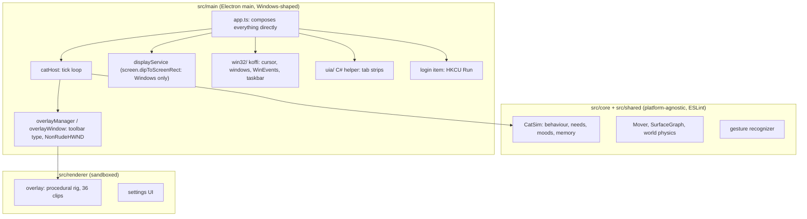
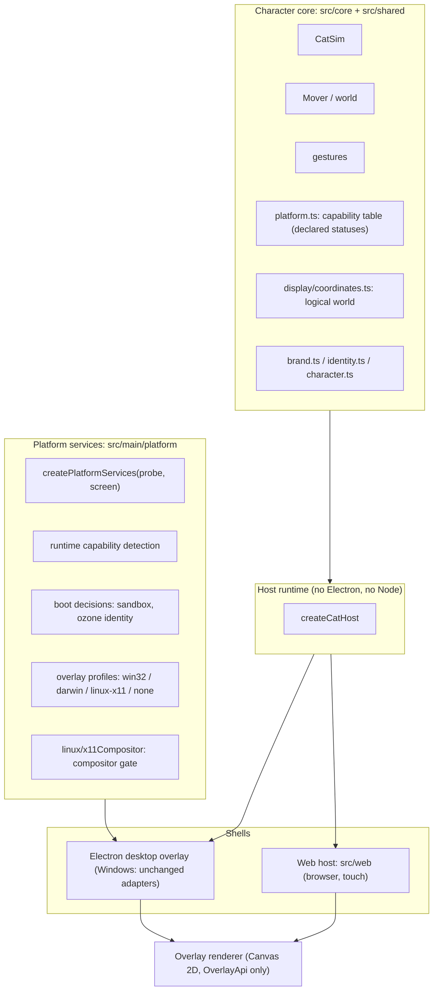

# GizeVerse architecture: before and after

Branch `feat/gizeverse-foundation`. Design: [ADR 0004](../adr/0004-gizeverse-platform.md). Labels: REAL means read from the code or executed here. The platform statuses are in the [capability matrix](capability-matrix.md).

## Before (v1.2.0, `58b4cd6`)

REAL facts about this state (audit §2):
- The core was already platform-agnostic.
- `app.ts` imported the Windows adapters directly, and every display read went through Windows-only Electron calls.
- Off Windows the world stayed empty, so no cat appeared (traced from code; never run).

## After (this branch)

### What changed, by layer

| Layer | Change | Files | Windows effect |
|---|---|---|---|
| Character core | Capability table and its honesty tests; logical coordinates; ESLint bans every Node built-in and every Node/DOM global in core/shared | src/shared/platform.ts, src/shared/capabilityMatrixDoc.ts, src/core/display/coordinates.ts, eslint.config.mjs | none |
| Host runtime | Unchanged: `createCatHost` already took everything by injection (REAL: it bundles for the browser). The web host reuses it as is. | src/main/catHost.ts | none |
| Platform services | One factory for every new per-OS decision; runtime capability record in `AppStatus.platform`; boot decisions | src/main/platform/*, src/main/linux/x11Compositor.ts | The win32 values are pinned by tests to v1.2's behaviour |
| Electron shell | Display service, capture and overlay `info()` take the coordinate strategy. Overlays take a profile and a gate. Tray balloons, the session-end window and the AppUserModelID only on win32. Off Windows the app saves on `powerMonitor` shutdown. A packaged build refuses `--no-sandbox`. The login item has an explicit unsupported-platform block. Coarse idle off Windows. | src/main/{app,index,tray}.ts, display/, overlay/, perception/, lifecycle/loginItem*.ts, win32/activityMonitor.ts | Same calls, same order (tests; adversarial review could not refute it). |
| Packaging | Per-platform builder sections; Linux AppImage/tar.gz and macOS dmg/zip targets | electron-builder.yml, package.json | Builder-config equivalence: the same `out/` packaged with the v1.2 config and with the new one gives 144 files, all SHA-256 identical (REAL). This proves the config move changes nothing; app.asar itself differs from 1.2.0 because the code changed (+26.8 KB, measured before the web build existed). |
| Web shell | The real sim, host and renderer in a page | src/web/** | none: `out/web*` is excluded from the desktop package (review H1, `60c408b`) |

### Shared core and adapters

| Concern | Shared (one implementation) | Per platform (adapter) |
|---|---|---|
| Behaviour, movement, physics, gestures, AI allow-list | src/core | — |
| Tick loop, click-through decision, guard bands | createCatHost, core/interaction | — |
| Rendering | src/renderer/overlay (Canvas 2D) | host bridge: preload (Electron) or in-page `OverlayApi` (web) |
| World coordinates | displayMath + coordinates.ts | `win32-physical` (Electron dip* calls) or `logical` |
| Overlay window | overlayManager | profile: window type, level, macOS options, Windows shell extras; gate: X11 compositor |
| Window surfaces, taskbar, tab strips, fullscreen | providers in src/main/surfaces | Windows only (koffi, UIA); elsewhere the existing "unavailable" stubs |
| Idle / activity | activityMonitor | GetLastInputInfo (Windows); powerMonitor at 1 s (macOS, Linux); page pointer (web) |
| Startup at sign-in | login-item reconcile | Windows only; explicit block elsewhere |
| Secrets | secretStore | DPAPI / Keychain / libsecret through safeStorage; Linux plaintext backends refused |
| Persistence | zod schemas, migrations | JSON files (Electron) or localStorage (web) |
| Perception | privacy gate, analysis | Windows capture only; fail-closed elsewhere |

### What is deliberately not generic yet

- **One character.** `CharacterDescriptor` documents the contract for a second character, but there is no generic sim (ADR 0004 §10, R13).
- **One Windows adapter set.** The Win32 facade keeps its name. Splitting it would touch about 40 files for no behaviour change.
- **No native mobile app** ([08-mobile-boundaries.md](08-mobile-boundaries.md)).
